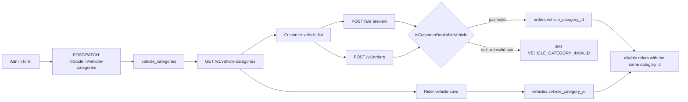

# Vehicle category and booking compatibility audit

Read-only audit of the staging catalog and the current source. No bookings, payments, OTP calls, database writes, or production calls were made.

Staging public `GET /v1/vehicle-categories` on `https://staging-api.idharudhar.co.in` returned HTTP 200. Launch city `01a18c7f-040b-7294-8ea3-ff21ae91d05e` (Ahmedabad `AMD`). All eight categories are active. Bike and Scooty have a vehicle pair. The other six have `vehicle_type` and `vehicle` null.

Admin was not opened and no category was saved.

## 1. Executive summary

The canonical id for a booking, a rider vehicle, and assignment is `vehicle_category_id`. The slug pair is a second gate. `OrdersService.requireCategory` and fare preview call `isCustomerBookableVehicle`, which returns false unless the row is active and the pair is one of seven allowed combinations. A null pair is valid in the database and is returned by the public catalog, the Customer list, and Rider registration. Create, quote, and confirm then reject it as `VEHICLE_CATEGORY_INVALID`.

Only Bike and Scooty are fully bookable. The other six are catalog-visible and rider-registrable, and blocked at booking by the backend.

Do not assign `loader_riksha` to Auto or 3W Tempo, or a truck slug to Tempo 407, Pickup, Chhota Hathi, or Truck / Eicher. Migration `0020` maps only exact display names, and its comment leaves Auto unset on purpose. Those names are not defined as the same vehicle.

A second defect appears only after a category becomes bookable. `parseSizeCm` reads the first number and treats a missing `cm` unit as centimetres. Feet strings such as `8 ft` and `5.5 ft long, ...` would be enforced as centimetres.

## 2. Flow

| Stage | Canonical key | What the slug does |
| --- | --- | --- |
| Admin create/update | `vehicle_category_id` | Optional. Both null is allowed. A partial or illegal pair is rejected. |
| Public catalog | `vehicle_category_id` | Returned as stored. Not used to hide rows. |
| Customer list | `vehicle_category_id` stored on the selected vehicle | Used for family, icon, and sort. Name fallback still shows a null pair. |
| Fare preview | `vehicle_category_id` on each returned line | Rows with no valid pair are omitted. |
| Create, quote, confirm | `vehicle_category_id` | Invalid or null pair is a 400. |
| Rider save | `vehicle_category_id` | Not checked. Any active category id is stored. |
| Assignment | `vehicles.vehicle_category_id = orders.vehicle_category_id` | Slug is not compared. |

## 3. Compatibility matrix

Live staging values from the public catalog. Source columns are from the files named in section 4.

| Category | DB category ID | DB slug | Admin read | Public API | Customer selectable | Booking API | Rider registration | Final status |
| --- | --- | --- | --- | --- | --- | --- | --- | --- |
| Bike | `01a18c7f-0435-720a-824d-7cb9a618da57` | `two_wheeler` / `bike` | Yes | Yes | Yes, Two Wheeler tile | Accepts | Yes | FULLY BOOKABLE |
| Scooty | `01a18c7f-045c-7542-af93-0e07e40a6ef7` | `two_wheeler` / `scooty` | Yes | Yes | Yes, Two Wheeler tile | Accepts | Yes | FULLY BOOKABLE |
| 3W Tempo | `01a18c7f-0483-7740-8e37-5bdd836f2159` | null / null | Read yes. Save renames | Yes | Yes, but under the Truck tile | Rejects | Yes | BLOCKED BY BACKEND |
| 3W Auto | `01a18c7f-04ac-7aa4-ae2e-11519aea01de` | null / null | Read yes. Save renames | Yes | Yes, Three Wheeler tile | Rejects | Yes | BLOCKED BY BACKEND |
| Chhota Hathi / Tata Ace | `01a18c7f-04d7-7a83-bb64-91afe3935cd0` | null / null | Read yes. Save renames | Yes | Yes, only under the Truck tile | Rejects | Yes | BLOCKED BY BACKEND |
| Pickup | `01a18c7f-0505-7105-a040-9ac900edc5b7` | null / null | Read yes. Save renames | Yes | Yes, only under the Truck tile | Rejects | Yes | BLOCKED BY BACKEND |
| Tempo 407 | `01a18c7f-053b-725b-84fa-bf4407562056` | null / null | Read yes. Save renames | Yes | Yes, Truck tile | Rejects | Yes | BLOCKED BY BACKEND |
| Truck / Eicher | `01a18c7f-0567-7eb1-94eb-7ff7c530e107` | null / null | Read yes. Save renames | Yes | Yes, Truck tile | Rejects | Yes | BLOCKED BY BACKEND |

None of the six is CATALOG ONLY. The apps show them. The order API refuses them. Rider assignment never runs because no order can be created. Rider registration itself does not block them.

Admin "supported" means the list can show the display name and a blank vehicle type. The save form cannot keep that display name. See Audit D.

## 4. Source map

### Backend model

Allowed pairs are fixed in `backend/src/catalog/vehicle-catalog.ts`:

- `two_wheeler`: `bike`, `scooty`
- `three_wheeler`: `loader_riksha` only
- `truck`: `mini_truck`, `tempo`, `large_tempo`, `truck`

`isVehiclePair` is the only legal combination check.

The same list is a database check in `records_database/migrations/0020_vehicle_category_hierarchy.sql`. Both columns null is allowed. The backfill updates only exact names: bike, scooty/scooter, loader riksha (three spellings), mini truck, large tempo, tempo, truck. The comment says unlisted names, including Auto, stay unset.

There is no unique index on `(vehicle_type, vehicle)`. Two rows could share one slug. Name uniqueness is enforced in `VehicleCategoriesService.assertNameAvailable`, not by a slug.

DTOs `CreateVehicleCategoryDto` and `UpdateVehicleCategoryDto` mark `vehicle_type` and `vehicle` optional and restrict each with `@IsIn`. Pair checking is in `resolveHierarchy`:

- Create or update with both blank stores null / null.
- Update that omits both fields keeps the stored pair.
- One side set, or an illegal pair, returns 400 `Vehicle does not belong to the selected vehicle type`.

`VehicleCategoriesService.listActive` returns every active row, including null pairs, plus `launch_city_id` from `findLaunchCityId` (active city code `AMD`).

`isCustomerBookableVehicle` in `backend/src/orders/vehicle-fare.ts` requires active plus a legal pair.

Call sites:

- `OrdersService.previewVehicleFares` filters with it before `serializeCustomerVehicleFare`.
- `OrdersService.requireCategory` uses it for create, quote, and confirm. Failure is `VEHICLE_CATEGORY_INVALID` / 400, even when the row exists and is active.
- `faresByVehicle` skips non-bookable rows.

`assertPackageForVehicle` in `backend/src/orders/package-constraints.ts` runs only after that gate. `parseCapacityKg` accepts `20 kg`. `parseSizeCm` takes the first number and allows a missing unit, so `8 ft` parses as 8 cm and `5.5 ft long, 4.5 ft wide, 5 ft high` parses as 5.5 cm. A parsed size makes `package_size_cm` required.

Assignment is `CatalogRepository.listEligibleOnlineRidersForCategory` and `OrdersRepository.listSearchingOrderIdsForRider`. Both compare `vehicle_category_id` only. Online, approved, presence, licence, and vehicle detail checks are separate. No slug filter.

Rider save is `IdentityRepository.upsertRiderVehicle`. It requires the category id to be active. It does not call `isCustomerBookableVehicle`. `twoWheelerSubtype` sets `BIKE` or `SCOOTER` from the display name and otherwise stores null. That subtype is not the booking key. The vehicles check constraint allows only `BIKE` and `SCOOTER` or null (`records_database/migrations/0004_files_vehicles_kyc.sql`).

Admin vehicle CRUD `VehiclesService.assertCategory` also accepts any active category id.

### Customer Flutter

`VehicleCategoryCatalog.parsePayload` keeps every active row with an id and name. It does not drop a null slug. `VehicleCategory.fromJson` stores `vehicle_type` and `vehicle` and does not reject them when null.

`VehicleSelectionScreen` maps the catalog to cards. `vehiclesForBookingFamily` then keeps the home-screen family:

- Two Wheeler: Bike, Scooty.
- Three Wheeler: 3W Auto, because the name contains `auto`.
- Truck: 3W Tempo, because the name contains `tempo` and does not contain `3 wheeler`. Also Tempo 407 and Truck / Eicher by the same name rule. Chhota Hathi and Pickup have no family from the name; `vehicleTypeForCategory` falls through to `VehicleType.truck`, so the Truck tile still shows them.

`ensureCustomerQuote` posts `draft.vehicle.id`, which is `vehicle_category_id`. The client does not send a slug. The backend rejects the six ids.

Fare preview prices only bookable rows. A category missing from a successful preview is labeled "Fare after route" when a route exists. That label does not mean the booking will succeed.

### Rider Flutter

`VehicleTypeScreen` lists every active catalog row and pushes the display name. `VehicleDetailsScreen` resolves that name back to `vehicle_category_id` and `saveVehicle` sends the id. Registration and booking therefore use the same id.

`RiderVehicleTypeX.fromLabel` only knows Bike, Auto, Mini Truck, and a few exact aliases. Unknown names, including Scooty, 3W Tempo, Pickup, and Truck / Eicher, become the local `bike` enum. The saved category name and id are still the catalog row. The enum is an icon fallback, not the server key.

### Admin

`IDHAR_UDHAR_ADMIN/src/data/vehicleCatalog.js` copies the same seven pairs. `issuesForVehicleCategoryForm` requires a pair. When the pair is valid it sets the saved name to `vehicleLabel(vehicle)` (Bike, Scooty, Loader Riksha, Mini Truck, Tempo, Large Tempo, Truck). `saveVehicleCategory` sends that computed name plus the pair.

The list column uses `vehicleTypeLabel` and prints an em dash when `vehicle_type` is empty. The name column stays the API name until someone saves. Saving one of the six would replace the display name with a canonical label and attach that slug. This audit did not save.

`deactivateVehicleCategory` sends only `{ active: false }`. The API update path keeps a omitted pair, so deactivate does not clear a slug.

## 5. Root cause for each blocked category

All six fail for the same backend reason. `0020` stored a null pair because the name is not in the exact-name list. `isCustomerBookableVehicle` then treats that legal null pair as not bookable. Create, quote, confirm, and fare preview share that function.

Extra customer placement issues, which do not themselves reject the booking:

| Category | Why it is not a supported pair | Customer tile |
| --- | --- | --- |
| 3W Tempo | Not `loader riksha`. Only one three-wheeler slug exists, and it is a loader. | Shown under Truck because the name contains `tempo`. |
| 3W Auto | Migration comment leaves Auto unset. It is not `loader_riksha`. | Shown under Three Wheeler. |
| Chhota Hathi / Tata Ace | Not the exact name `mini truck`. | Shown under Truck only because the mapper defaults an unknown name to `VehicleType.truck`. |
| Pickup | No `pickup` slug. | Same default. |
| Tempo 407 | Not the exact name `tempo`. | Shown under Truck because the name contains `tempo`. |
| Truck / Eicher | Not the exact name `truck`. | Shown under Truck because the name contains `truck`. |

## 6. Recommended architecture

Keep `vehicle_category_id` as the only booking, rider, and assignment identity. That is already how orders and `vehicles` are stored.

Treat the slug as classification for icons and grouping. An active category with a null pair is already a supported database state. The booking gate should accept that state. An illegal mixed pair should stay rejected.

Do not fill the six rows with an existing slug unless the business states that the display name is that vehicle. The current source does not define these equivalences:

- 3W Tempo is not `loader_riksha` and not truck `tempo`.
- 3W Auto is not `loader_riksha`.
- Chhota Hathi / Tata Ace is not `mini_truck`.
- Pickup is not `large_tempo` or `tempo`.
- Tempo 407 is not `tempo`.
- Truck / Eicher is not `truck`.

Adding new slugs is the alternative if the product must keep a closed list. That needs a new migration to widen the check constraint, plus the same lists in `vehicle-catalog.ts` and the Admin catalog. It is a larger change and still needs the business to name each slug. It is not required to make the current eight bookable by category id.

Fare math, waiting, commission, and the 85/15 split stay on `fare_config_version_rates` and do not need to change for either option.

Before the six can accept parcels, `parseSizeCm` must stop reading feet and multi-axis text as centimetres. That is package validation, not the fare formula. Bike `36 cm` and 3W Auto `60 cm` already match the centimetre parser.

Admin save must stop replacing `name` with the slug label, or operators will rename these categories the first time they edit a fare.

Customer family detection should classify `3W Tempo` as a three-wheeler, and should not rely on a truck default for Chhota Hathi and Pickup.

## 7. Minimal implementation plan

Do not start until the approval list in section 10 is answered.

1. Confirm the product rule: an active category with a null pair and an active fare may be booked by `vehicle_category_id`.
2. Change `isCustomerBookableVehicle` so a null pair on an active row is bookable, and a present but illegal pair is still not. Keep Bike and Scooty on their current pairs.
3. Add backend tests for these eight ids or equivalent fixtures: null pair accepted; mixed pair still rejected; preview includes the null-pair row; Bike and Scooty still quote.
4. Fix `parseSizeCm` so a feet string or a length/width/height string does not become a centimetre limit. Add tests for `36 cm`, `60 cm`, `8 ft`, and the 3W Tempo size sentence.
5. Adjust `serviceFamilyForCategory` so a leading `3W` is three-wheeler before the `tempo` word match, and so Chhota Hathi and Pickup are not forced to the truck icon unless their names say so.
6. Change Admin `issuesForVehicleCategoryForm` so the typed display name is saved, and the vehicle dropdown stays optional for a row that has no pair. Deactivate must still omit the pair.
7. Do not add slugs, do not run a migration, and do not change fare or waiting calculation in this path.
8. Staging verification only after implementation: read the public catalog, confirm preview includes eight ids, and confirm one rejected mixed-pair fixture. Do not create a live order in that first check unless a later test plan says so.

A new-slug design replaces steps 2 and 6 with a migration and matching enum updates, and still needs a name for each new slug. That is the larger option.

## 8. Test plan

Existing coverage:

| Area | File | Gap |
| --- | --- | --- |
| Seven legal pairs accepted; null pair and mixed pair rejected on create, quote, confirm | `backend/src/orders/vehicle-fare.service.spec.ts` | No staging ids. Null pair is expected to fail. That test must change if the gate changes. |
| Preview map drops inactive rows | `backend/src/orders/vehicle-fare.spec.ts` | No null-pair row. |
| Pair helpers | `backend/src/catalog/vehicle-catalog.spec.ts` | Does not cover booking. |
| Admin category API | `backend/test/admin-vehicle-categories.e2e-spec.ts` | Null pair create is allowed. |
| Category service | `backend/src/catalog/vehicle-categories.service.spec.ts` | Not a booking test. |
| Dispatch matches category id | `backend/src/orders/dispatch-after-confirm.spec.ts` | Does not use the six names. |
| Customer display order and `loader_riksha` maps to auto | `idhar_udhar/test/customer/vehicle_display_order_test.dart`, `production_booking_rules_test.dart` | No 3W Tempo versus Truck tile case. |
| Catalog parse keeps active rows | `idhar_udhar/test/shared/vehicle_category_catalog_test.dart` | Does not drop null slugs. |
| Admin form requires a pair and renames | `IDHAR_UDHAR_ADMIN/src/data/vehicleCatalog.spec.js` | Confirms the save limitation. |

Missing tests:

- Each of the eight category ids through preview and create, with the current null pairs.
- Booking rejection of a mixed pair remains.
- Bike and Scooty quote regression after the gate change.
- `parseSizeCm` for centimetres versus feet and three-axis text.
- Customer family: `3W Tempo` is not placed on the Truck tile; `3W Auto` stays on Three Wheeler; Bike and Scooty stay on Two Wheeler.
- Rider save accepts an active null-pair category id and stores that id.
- Assignment still matches category id and does not match by slug.
- Admin save of a null-pair row keeps the display name.

Do not run tests that insert staging orders, riders, or payments.

## 9. Production compatibility and rollout

Bike and Scooty stay on `two_wheeler` / `bike` and `two_wheeler` / `scooty`. Existing orders store `vehicle_category_id` and a name snapshot. Changing the bookable check does not rewrite those rows.

Rider profiles store `vehicle_category_id`. A rider already on Bike or Scooty still matches those orders. A rider later registered on a newly bookable category matches only that category id.

Production was not read. If production has other active categories with a null pair, the same code change would make them bookable. Read the production catalog, without writing, before any production deploy. That read is not part of this audit.

No migration is required for the null-pair booking rule. A new-slug design does require a migration and a deploy of API, Admin, and both Flutter apps together, because the check constraint and the three copies of the slug list must match.

Fare versions, waiting minutes, and commission percentages are untouched by the bookable check. Do not republish fares as part of this change.

The size parser fix can reject or allow parcels differently for any category whose size text is not a centimetre value. Bike and Scooty sizes are `36 cm` and stay numeric centimetres. Confirm production size strings before that parser change ships.

## 10. Approval required before implementation

1. Allow booking of an active category whose vehicle pair is null, using `vehicle_category_id` only.
2. Leave the six staging rows without a slug. Do not map them onto `loader_riksha`, `mini_truck`, `tempo`, `large_tempo`, or `truck`.
3. If a closed slug list is required instead, approve the exact new slug for each of the six names. This audit does not choose those names.
4. Allow the Admin form to save the current display names without substituting the slug label.
5. Approve a package-size parser change so feet and multi-axis text are not treated as centimetres, before those categories take parcel bookings.
6. Approve Customer tile placement for 3W Tempo, Chhota Hathi, and Pickup.
7. Approve a production catalog read before any production rollout.

## Audit close

| Check | Result |
| --- | --- |
| Files modified | This report only |
| Database writes | 0 |
| AWS changes | 0 |
| Production access | 0 |
| All eight currently bookable | No. Bike and Scooty only |
| Next step | Approve item 1 in section 10, then change `isCustomerBookableVehicle` without adding slugs |

Files inspected include `vehicle-catalog.ts`, migration `0020`, `vehicle-fare.ts`, `orders.service.ts`, `package-constraints.ts`, `catalog.repository.ts`, `identity.repository.ts`, `vehicle-categories.service.ts`, the category DTOs, Admin `vehicleCatalog.js` and `vehicleCategories.js`, Customer `vehicle_selection_screen.dart`, `vehicle_category_catalog.dart`, `booking_api.dart`, and Rider `vehicle_type_screen.dart`, `vehicle_details_screen.dart`, and `vehicle_info.dart`. The staging public catalog was read with GET only.
